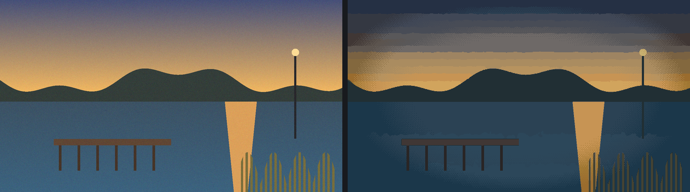
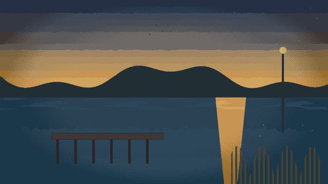
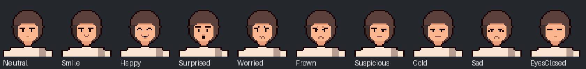
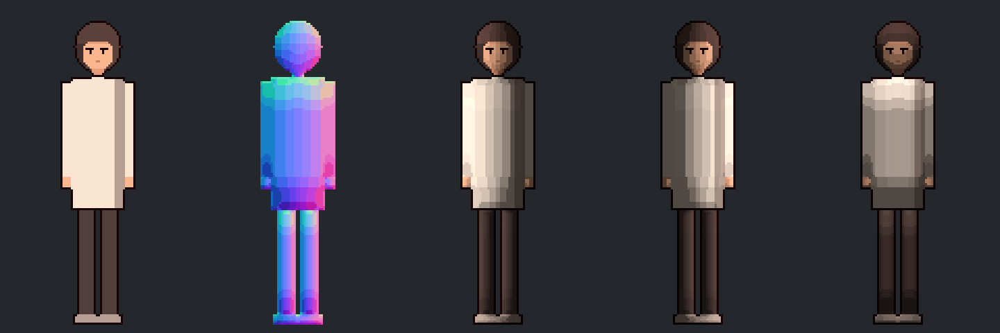
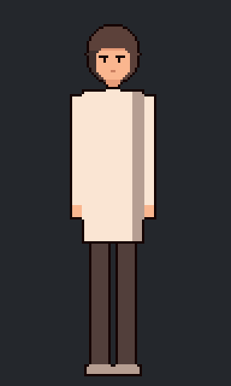

# concept-to-pixel-assets

An agent skill (Claude Code / Claude apps) plus a Python toolkit that turns **concept art** into **finished
pixel-art game assets**:

- **Scenes**: a concept painting or AI image becomes a native 640×360 pixel still in a hand-drawn style (24
  colours, colour grade, dithered vignette). It can also get a **seamless 48-frame ambient loop** (water, mist,
  foliage, leaves, dust, birds, lamp flicker) or **parallax layers** for scrolling cameras, and every pack comes
  with a review PDF.
- **Characters**: one front concept becomes a **1x sprite** on a shared canvas with **expressions**, idle (breathing
  + blink), talk, expression-change clips hidden inside blinks, nod / slow nod / head shake and custom one-shots.
  Each pack also has **pixel-art normal maps** for 2D lights, TexturePacker-style sheets + json, previews, an
  interactive HTML preview and **Unity** import scripts.

The workflow came out of many review rounds on a real game project. The rules in `SKILL.md` are the corrections
that came up again and again: eyes only blink, hair only moves when something moves it, rigid things never wobble,
every frame stays inside the still's palette, expression changes happen inside a blink, and so on.

| Concept → pixel still | 48-frame loop (palette-locked) |
|---|---|
|  |  |

| Expressions (face rig) | Normal maps: colour / normals / left / right / top light | Expression change inside a blink |
|---|---|---|
|  |  |  |

*(All images above come from the synthetic demo. The repo ships no real artwork.)*

## Install

```bash
pip install -r requirements.txt     # numpy scipy scikit-image opencv-python-headless Pillow reportlab
# plus ffmpeg on PATH for review videos
python scripts/demo/run_demo.py /tmp/pixkit_demo     # end-to-end smoke test, ~1 min
```

**As a skill:**
- **Claude Code**: copy (or `git clone`) this folder to `~/.claude/skills/concept-to-pixel-assets/` (personal) or
  `<project>/.claude/skills/concept-to-pixel-assets/` (one project).
- **Claude apps with custom skills**: zip the folder and upload it as a skill.

Claude then uses it when you paste scene or character art and ask for pixel versions, loops, expressions, normal
maps or Unity packs.

## Layout

```
SKILL.md                    workflow + house rules (what the agent reads first)
references/                 detailed guides, loaded only when needed
  scene-pipeline.md         stylize, AI-artifact and logic fixes, grades, shared palettes
  scene-loops.md            effect catalogue, failure modes, lamp flicker, CG people, image-to-video, parallax
  character-pipeline.md     concept → 1x base sprite, face redraw, ASCII editing
  character-animation.md    face rig, expression design, clip set and timings, motion rules, walk extensions
  normal-maps.md            normal method, part rules, Unity 2D lights, stepped-light shader notes
  packaging.md              pack layouts, json / manifest formats, README template, review PDF
  qa-checklist.md           automated + visual checks, failure → fix table
scripts/
  scene_to_pixel.py         concept → stylized (stage 1) → graded, palette-locked still (stage 2)
  make_loop.py              JSON spec of effects + masks → seamless loop frames + review mp4 + audit
  sprite_from_concept.py    character concept → 1x draft on the canvas (+ material ramps), ASCII dumps
  build_character.py        base + featureless face + config → full sprite pack + audit
  make_review_pdf.py        JSON spec → review PDF
  demo/run_demo.py          synthetic end-to-end test
  pixkit/                   the library (palette, scene, loopfx, parallax, video, sprite, face, motion,
                            normals, pack, audit, review_pdf)
assets/
  preview_template.html     interactive sprite preview (zh / en UI)
  unity/*.cs.tmpl           Unity editor scripts: build .anim clips from sheets, assign normal maps
  examples/                 character.example.json, materials.example.json, loop_spec.example.json,
                            review_spec.example.json
```

## Quick use without an agent

```bash
# scene
python scripts/scene_to_pixel.py concept.png out --name BG01                 # -> out/BG01_stylized.png
#   ...fix by hand / in code, save as out/BG01_fixed.png...
python scripts/scene_to_pixel.py out/BG01_fixed.png out --name BG01 --finish  # -> out/BG01.png + _1920
python scripts/make_loop.py loop_spec.json                                    # masks + effects -> loop

# character
python scripts/sprite_from_concept.py hero.png work --height 148 --materials materials.json
#   ...finish the base and the featureless face by hand...
python scripts/build_character.py character.json
```

The fully automatic steps produce drafts. A finished asset still needs the hand passes described in `SKILL.md`,
mainly the face redraw and the AI-artifact fixes. Those passes are where the quality comes from, and they are what
the agent is instructed to do.

## 中文简介

把一张概念图（场景或角色）做成可以直接进游戏的像素资源：
- **场景**：640×360 手绘感像素静帧，每张 24 色，带调色和抖动暗角。可以加 48 帧无缝环境循环（湖面、雾、草木、落叶、灰尘、飞鸟、灯闪），或拆成视差分层，并附评审 PDF。
- **角色**：1x 正面立绘，加一套表情：每个表情有待机（呼吸+眨眼）和说话；表情切换藏在眨眼里；还有点头、摇头和自定义表演动画。另有法线图、图集 json、预览和 Unity 导入脚本。

`SKILL.md` 里的规则来自真实项目的多轮评审，例如：
- 眼睛只眨眼不乱看；
- 头发只在被带动时才动；
- 护栏、道路这类刚体不晃；
- 所有帧只用原图的颜色；
- 表情切换在闭眼那一帧完成。

## License

MIT, see `LICENSE`.
